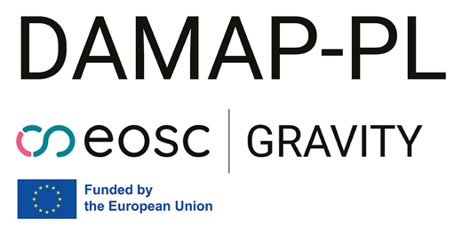
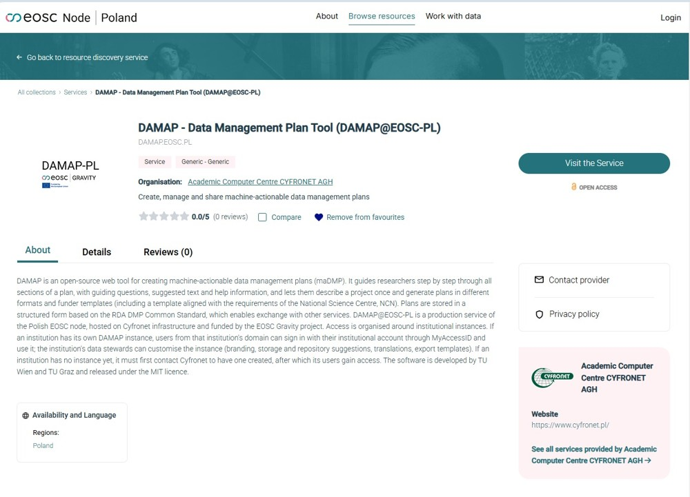

# DAMAP now runs in the Polish EOSC Node

By Tomasz Miksa
{ .blog-author }

DAMAP is now available as a service in the Polish EOSC Node. The DAMAP-PL project, which brought it there, has ended successfully. In this post we explain what the project set out to do, what it delivered and what we learned along the way.

<!-- more -->

## What DAMAP-PL was about

DAMAP@EOSC-PL was funded through the EOSC Gravity Inter-Projects Grants. It ran for six months, from May to November 2026, with three partners. TU Wien develops DAMAP and coordinated the project. Cyfronet, the Academic Computer Centre of AGH University in Kraków, hosts the service and connects it to the Polish EOSC Node. Gdańsk University of Technology (Gdańsk Tech) led the training of data stewards. Our goal was simple. We wanted a stable DAMAP service in the node, adapted to Polish needs, and people who know how to use it.

*DAMAP in the EOSC Poland catalogue.*

## One tenant for every institution

A researcher writes a DMP because a funder asks for one. The data steward makes sure that the DMP is good. In DAMAP-PL every institution has its own tenant, and its data stewards administer it themselves. In the admin interface they set the banner, logo and colours, edit texts and translations, choose recommended storage and repositories and add export templates. They can also define default suggested answers, which point researchers to the right choices. This is why exports get better. The steward shapes what researchers see, and the researcher starts from a sensible answer instead of a blank page.

The first funder template we added is the one for the National Science Centre Poland (NCN). It follows the structure of the NCN form and reminds authors of the character limit in the national submission system. Researchers can generate a plan in the shape the funder expects.

## Training the data stewards

Gdańsk Tech ran hands on workshops for data stewards. In total 25 data stewards from 8 institutions took part, more than the 20 stewards from 5 institutions we aimed for. They came from AGH University of Krakow, Adam Mickiewicz University in Poznań, Nicolaus Copernicus University in Toruń, Warsaw University of Technology, Lublin University of Technology, the University of Gdańsk, the Medical University of Gdańsk and Gdańsk Tech. Each institution left with a tenant it can adapt and use in its own training. A working tool also makes it easier for stewards to argue at their institution for long term use.

Participants liked the intuitive workflow, the guidance within each step and the version tracking of plans. The [training materials](https://pg.edu.pl/biblioteka-pg/dzialalnosc/projekty/damap-pl) stay online, so everyone can return to them.

## What we learned

Three things stand out. First, deployment was straightforward, because the deployment of DAMAP is automated and scripted. Second, a tenant puts the tool in the hands of the data stewards. After the training they had something to work with, not only slides. Third, adapting funder templates can be easy. The NCN template was a must for Poland, but it is very similar to the Science Europe template that DAMAP already had. Adapting it was therefore relatively easy.

## What comes next

Many trainings give data stewards ideas, but it is hard to turn them into practice. In DAMAP-PL the stewards left with a tool they can use right away, and they can start improving the DMPs of their researchers straight after the training. We want to reach more data stewards in the same way. Their feedback is a valuable contribution to the tool and goes straight into DAMAP. We also want to onboard DAMAP into other EOSC Nodes and to look for further ways to fund the development of DAMAP. If your node or institution is interested, write to [info@damap.org](mailto:info@damap.org).

## Thank you

This result is the work of many people. At Cyfronet we thank Roksana Wilk, Katarzyna Lechowska-Winiarz, Alicja Świerad and Wojciech Ziajka. At Gdańsk Tech we thank Magdalena Szuflita-Żurawska, Marta Kuźma and Piotr Krajewski. At NCN we thank Natalia Galica. At TU Wien we thank Valentin Futterer and Sotiris Tsepelakis. We also thank all the data stewards who joined the training.

## Frequently asked questions

**How is DAMAP-PL different from DAMAP Cloud?** DAMAP-PL does not replace DAMAP Cloud, the shared service that TU Wien offers to institutions everywhere. The Polish service works in a similar way, but a different institution operates it and it follows a different sustainability model. DAMAP Cloud serves predominantly the Austrian community, while the Polish deployment has its primary focus on the Polish community within EOSC Poland. DAMAP Cloud is run by the DAMAP team at TU Wien, and the contributions of its users help us to keep developing DAMAP for everyone.

**How can my institution get a tenant?** Ask Cyfronet to create one through the contact button on the [service page](https://marketplace.eosc.pl/services/damap-data-management-plan-tool-damap-eosc-pl). After that, your users can sign in with their institutional accounts.

**What does it cost?** DAMAP is free of charge within EOSC Poland for now.

**Which option fits my institution?** Institutions in Poland can ask Cyfronet for a tenant. Everyone else can use DAMAP Cloud from TU Wien or host DAMAP themselves. Write to [info@damap.org](mailto:info@damap.org) and we will help you choose.

**Can I try DAMAP outside Poland?** Yes. You can request a test account on the [DAMAP website](../../index.md#try-it-out) or by writing to [info@damap.org](mailto:info@damap.org).

**How can I stay informed?** Join our [community meeting](../../index.md#community), held on the last Tuesday of every month, or write to us.
